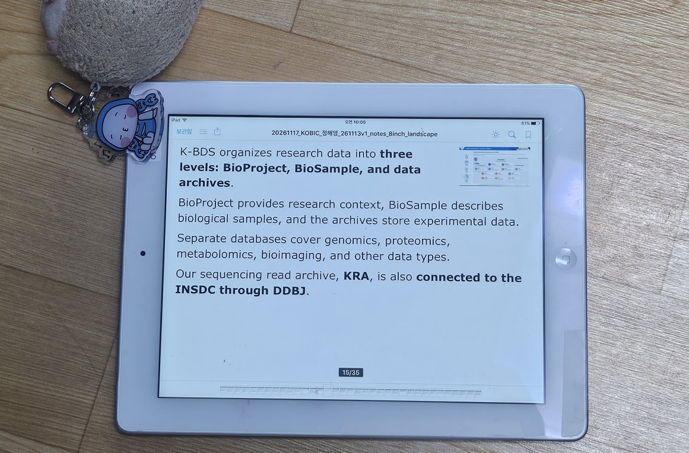

# PPTX Notes Exporter

A small Python script that turns PowerPoint speaker notes into **iPad-friendly PDF reading sheets**, with optional slide thumbnails, a Markdown transcript, and a ZIP archive of slide images.

## Why I made this

I wanted to use an **old iPad as a dedicated presenter-notes reader** during a talk. The presentation runs on the venue's computer, while the iPad shows my speaking notes independently—no Presenter View, second monitor, or network connection required during the talk.

<p align="center">
  
</p>

The PDFs are designed to be readable on a classic **4:3 iPad screen** (including older 9.7-inch models). Each slide's notes occupy one PDF page, with a small slide preview for orientation. The preview is only a visual cue; the notes are the main content. Both landscape and portrait PDFs are generated so I can choose whichever works better on the device.

## Features

- One PDF page per slide **with speaker notes**; both landscape and portrait versions
- Default **4:3** layout for classic iPads; optional **16:10** or **A4**
- Large, automatically adjusted text, with notes flowing beside and below the thumbnail
- Preserves bold formatting from PowerPoint notes where available
- Uses **Verdana** for Latin text and a CJK-capable fallback font where available
- Exports all notes as a **Markdown (`.md`)** file
- Archives exported **960 × 540 PNG** slide images in a ZIP file, including slides without notes
- Runs as a single Python script

## Prerequisites

- **Python 3**
- Python packages: `python-pptx` and `reportlab`
- **Windows with Microsoft PowerPoint installed** for slide thumbnail PNG export
- `pywin32` for controlling PowerPoint on Windows

Install the Python packages:

```bash
python -m pip install python-pptx reportlab pywin32
```

On systems without Windows PowerPoint, omit `pywin32` and use `--no-thumbnails`. PDF notes and Markdown export still work, but slide previews and the PNG ZIP will not be generated.

**Fonts:** Verdana and Malgun Gothic are expected on typical Windows installations. The script attempts alternative CJK fonts on other systems. Font availability may affect the appearance of the PDFs.

## Usage

Place `pptx_notes_exporter.py` alongside your presentation, or supply the full path to the `.pptx` file:

```bash
python pptx_notes_exporter.py presentation.pptx
```

The default output is optimized for classic **4:3 iPads**. Both PDF orientations are produced automatically.

### Other screen sizes and paper

```bash
python pptx_notes_exporter.py presentation.pptx --aspect 16:10
python pptx_notes_exporter.py presentation.pptx --aspect A4
```

### Choose an output directory

```bash
python pptx_notes_exporter.py presentation.pptx --output-dir output
```

### Adjust text size

```bash
python pptx_notes_exporter.py presentation.pptx --base-font 23 --max-font 24
python pptx_notes_exporter.py presentation.pptx --min-font 10
```

The script tries to keep text size consistent, enlarging short notes slightly and shrinking dense notes only when necessary. If notes cannot fit on a single page at the minimum font size, it reports an error.

### Skip optional exports

```bash
python pptx_notes_exporter.py presentation.pptx --no-thumbnails
python pptx_notes_exporter.py presentation.pptx --no-image-zip
python pptx_notes_exporter.py presentation.pptx --no-markdown
```

`--no-thumbnails` also disables the slide-image ZIP because there are no PNGs to archive. Without thumbnails, the PDFs display a placeholder in the preview area.

### Help and version

```bash
python pptx_notes_exporter.py --help
python pptx_notes_exporter.py --version
```

## Output files

For an input named `presentation.pptx`, the default outputs are saved next to the presentation:

| File | Purpose |
| --- | --- |
| `presentation_notes_8inch_landscape.pdf` | Landscape notes PDF |
| `presentation_notes_8inch_portrait.pdf` | Portrait notes PDF |
| `presentation_notes.md` | Complete notes, organized by slide |
| `presentation_slides_png.zip` | Exported slide PNGs at 960 × 540 pixels |

The ZIP contains the PNGs exported from PowerPoint, **not the original embedded photos or graphics**. PNG export requires PowerPoint and `pywin32`.

**Note:** The PDF filenames retain `_8inch_` for compatibility even when `--aspect 16:10` or `--aspect A4` is used. Running again with another aspect ratio overwrites the PDFs with those same filenames. Use `--output-dir` to keep multiple versions.

## Using the PDFs on an iPad

1. Generate the PDFs on your computer.
2. Transfer the preferred landscape or portrait PDF to the iPad using a file-transfer method supported by your device.
3. Open it in a PDF reader and advance one page as each presentation slide changes.
4. If needed, disable automatic screen locking and check battery life before presenting.

The iPad does **not** need to run PowerPoint or connect to the presentation computer. It is simply an independent notes display.

## Limitations

- The script reads **speaker notes from `.pptx`**, not the visible text of each slide.
- Slides without speaker notes do not get PDF notes pages, but their images are included in the ZIP when image export succeeds.
- PowerPoint is required to render thumbnails; the Python libraries alone do not render slides.
- Very long notes may not fit on a single PDF page, even at the minimum font size.
- Slide previews are exported at a fixed 960 × 540 (16:9) size; presentations with another slide aspect ratio may need adjustments.

## Version

**1.0.0** — Initial release.
